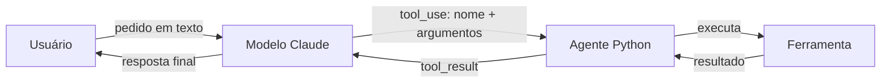

# 💰 Agente Financeiro com IA Generativa

**Um agente em Python que entende pedidos financeiros em linguagem natural e decide sozinho qual ferramenta executar.**


Você escreve algo como *"analise a coluna fechamento do acoes_exemplo.csv"* e o agente escolhe a ferramenta certa, extrai os argumentos do texto, executa o código Python e responde com o resultado explicado. O modelo de linguagem decide **o que** fazer; o código Python garante que o cálculo seja **exato**.

---

## Como funciona

O projeto usa **tool use** (também chamado de function calling) da API da Anthropic. Cada ferramenta é uma função Python comum, descrita para o modelo com um nome, uma explicação e um schema JSON dos argumentos.



1. O usuário envia uma mensagem.
2. O modelo lê a mensagem e a lista de ferramentas disponíveis e decide se precisa de alguma delas.
3. Se precisar, devolve um bloco `tool_use` com o nome da ferramenta e os argumentos.
4. O agente executa a função Python correspondente e devolve o resultado num bloco `tool_result`.
5. O ciclo se repete até o modelo ter informação suficiente para responder em texto. Em uma mesma resposta o modelo pode pedir mais de uma ferramenta, e todas são executadas.

Um exemplo real de encadeamento: diante de *"gere um gráfico de fechamento por data usando acoes_exemplo.csv"*, o modelo pode primeiro chamar `inspecionar_csv` para descobrir os nomes das colunas e só depois chamar `gerar_grafico_csv` com `coluna_x="data"` e `coluna_y="fechamento"`.

## Ferramentas disponíveis

| Ferramenta | O que faz |
|---|---|
| `status_acao` | Compara abertura e fechamento e diz se a ação teve ALTA, BAIXA ou ficou ESTAVEL |
| `calcular_saldo` | Soma receitas e subtrai despesas a partir de lançamentos como `R 100.00,D 50.00` |
| `remover_duplicatas` | Remove identificadores de transação repetidos, mantendo a ordem original |
| `converter_maiusculas` | Padroniza textos, como nomes de destinatários, em letras maiúsculas |
| `estatisticas_serie` | Calcula quantidade, média, mediana, desvio padrão, mínimo e máximo de uma série |
| `gerar_grafico` | Gera gráfico de linha ou barra (PNG) a partir de valores digitados na conversa |
| `inspecionar_csv` | Mostra colunas, quantidade de linhas e uma amostra de um CSV da pasta `dados/` |
| `analisar_csv` | Calcula estatísticas descritivas de uma coluna numérica de um CSV |
| `gerar_grafico_csv` | Gera gráfico de uma coluna em função de outra (por exemplo, fechamento por data) |

As implementações ficam em `src/ferramentas.py`. As descrições e schemas que o modelo enxerga ficam em `src/agente.py`, na lista `FERRAMENTAS`.

## Exemplos de uso

```text
Você: A ação abriu a 10 e fechou a 15, como ela se saiu?
      → status_acao(abertura=10, fechamento=15)  →  "ALTA"

Você: Calcule o saldo de: R 100.00,D 50.00,R 20.00
      → calcular_saldo(lancamentos="R 100.00,D 50.00,R 20.00")  →  70.0

Você: Quais as estatísticas desses preços: 32,34,31,36,40,38,42?
      → estatisticas_serie(valores="32,34,31,36,40,38,42")
      →  média 36.14 · mediana 36.0 · desvio padrão 4.1 · mínimo 31.0 · máximo 42.0

Você: Analise a coluna fechamento do acoes_exemplo.csv
      → analisar_csv(nome_arquivo="acoes_exemplo.csv", coluna="fechamento")
      →  10 registros · média 34.82 · mínimo 31.9 · máximo 38.25
```

A linha com a seta mostra a ferramenta que o modelo escolheu e o que ela devolveu. A partir desse resultado, o agente responde ao usuário em linguagem natural.

## Visualização de dados

Exemplos de gráficos gerados pelo projeto com dados demonstrativos. Os gráficos criados durante o uso são salvos na pasta `graficos/`.

### Evolução do patrimônio


### Receitas mensais


## Decisões técnicas

**Limite de ciclos (`MAX_CICLOS_AGENTE = 8`).** Um agente que chama ferramentas em loop pode, em caso de erro ou ambiguidade, continuar pedindo ferramentas indefinidamente e consumir chamadas de API sem parar. O ciclo é limitado a 8 rodadas; se chegar ao limite, o agente encerra com uma mensagem clara em vez de travar.

**Erros devolvidos ao modelo com `is_error`.** Se uma ferramenta falha (argumento inválido, arquivo inexistente, ferramenta desconhecida), a exceção não derruba o programa nem é escondida. Ela volta para o modelo como `tool_result` marcado com `is_error: True`, com o tipo e a mensagem do erro. Assim o modelo sabe que a chamada falhou e pode corrigir os argumentos ou explicar o problema ao usuário.

**Validação antes de executar.** `executar_ferramenta` só aceita ferramentas registradas em `IMPLEMENTACOES` e argumentos em formato de dicionário. O nome escolhido pelo modelo nunca vira código executado diretamente.

**Separação entre contrato e implementação.** O que o modelo vê (nome, descrição e schema em `FERRAMENTAS`) fica separado do que roda de fato (funções em `ferramentas.py`, ligadas pelo dicionário `IMPLEMENTACOES`). Dá para testar cada função isoladamente e adicionar uma ferramenta nova sem mexer no ciclo do agente.

**Resultados estruturados em JSON.** Ferramentas que retornam dicionários (estatísticas, inspeção de CSV) têm o resultado serializado com `json.dumps`, o que facilita a leitura pelo modelo e preserva acentos.

**Acesso a arquivos restrito à pasta `dados/`.** As ferramentas de CSV usam só o nome do arquivo (`os.path.basename`), então um pedido como `../../senhas.csv` não consegue sair da pasta do projeto.

**Cálculos feitos em código, não pelo modelo.** O modelo interpreta o pedido e escolhe a ferramenta, mas média, saldo e desvio padrão são calculados em Python. Isso evita erros de conta típicos de modelos de linguagem.

## Testes

São **33 testes automatizados**, e nenhum deles chama a API real:

| Arquivo | O que valida |
|---|---|
| `tests/test_ferramentas.py` | As 9 ferramentas, incluindo casos de borda: entrada vazia, valor único, arquivo inexistente, coluna inexistente |
| `tests/test_agente.py` | A orquestração: ferramenta desconhecida, argumentos inválidos, resposta direta sem ferramenta e o ciclo completo de tool use |

Nos testes do agente, o client da Anthropic é substituído por um `Mock` que devolve respostas montadas à mão. Isso permite verificar o ciclo inteiro (pedido de ferramenta, execução, `tool_result` com o `tool_use_id` correto e resposta final) sem custo de API e com resultado sempre igual.

```bash
python -m pytest -v
```

## Estrutura do projeto

```text
agente-financeiro/
├── src/
│   ├── __init__.py
│   ├── agente.py          # schemas das ferramentas, ciclo de tool use e interface de linha de comando
│   └── ferramentas.py     # implementação das 9 ferramentas
├── dados/
│   └── acoes_exemplo.csv  # dados demonstrativos (PETR4)
├── graficos/              # gráficos gerados
├── tests/
│   ├── test_agente.py
│   └── test_ferramentas.py
├── requirements.txt
└── README.md
```

## Como executar

**1. Clone o repositório**

```bash
git clone https://github.com/KarineF-dev/agente-financeiro.git
cd agente-financeiro
```

**2. Crie e ative um ambiente virtual**

```bash
python -m venv venv
```

Windows (PowerShell):

```powershell
.\venv\Scripts\Activate.ps1
```

Linux ou macOS:

```bash
source venv/bin/activate
```

**3. Instale as dependências**

```bash
pip install -r requirements.txt
```

**4. Configure a chave da API**

Crie uma chave no [Console da Anthropic](https://console.anthropic.com/) e defina a variável de ambiente:

```powershell
# Windows (PowerShell)
$env:ANTHROPIC_API_KEY="sua_chave_aqui"
```

```bash
# Linux ou macOS
export ANTHROPIC_API_KEY="sua_chave_aqui"
```

A chave nunca deve ser escrita no código nem enviada ao GitHub. O arquivo `.env` já está no `.gitignore`.

**5. Rode o agente**

```bash
python -m src.agente
```

Digite `sair` para encerrar. Para analisar seus próprios dados, coloque um arquivo CSV na pasta `dados/` e peça ao agente pelo nome do arquivo.

## Próximos passos

- [ ] Usar `Decimal` em `calcular_saldo` para evitar imprecisão de ponto flutuante em valores monetários
- [ ] Aceitar preços decimais em `status_acao` (tipo `number` no schema, em vez de `integer`)
- [ ] Validar se as colunas são numéricas antes de gerar gráficos a partir de CSV
- [ ] Testes para o limite de ciclos e para o retorno de erros com `is_error`
- [ ] Controlar o tamanho do histórico da conversa para não estourar a janela de contexto
- [ ] Criar um conjunto de avaliação com pedidos e a ferramenta esperada para medir a taxa de acerto do agente
- [ ] Rodar os testes automaticamente a cada push com GitHub Actions

---

Desenvolvido por **Karine** · estudante de Análise e Desenvolvimento de Sistemas na FATEC Ipiranga · [GitHub](https://github.com/KarineF-dev)