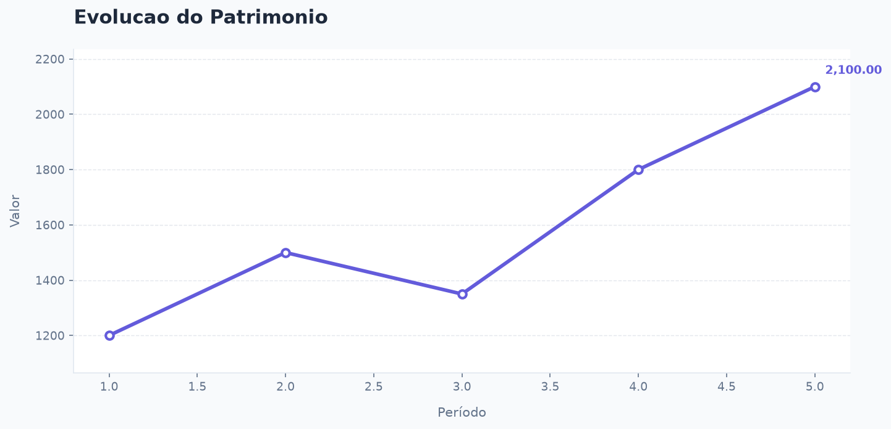
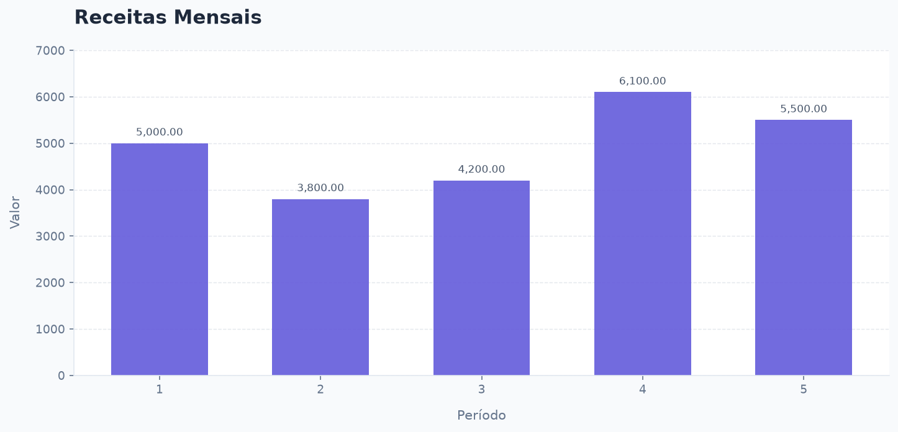

# 💰 Agente Financeiro com IA Generativa

Agente financeiro desenvolvido em Python utilizando a API da Anthropic e o conceito de **Tool Use (uso de ferramentas)**.

O projeto utiliza inteligência artificial generativa para interpretar solicitações em linguagem natural e decidir autonomamente qual ferramenta Python executar para realizar análises e operações financeiras.

## 🚀 Funcionalidades

O agente possui as seguintes ferramentas:

| Ferramenta | Descrição |
|---|---|
| `status_acao` | Identifica se uma ação teve ALTA, BAIXA ou ESTABILIDADE. |
| `calcular_saldo` | Soma receitas e subtrai despesas de um extrato. |
| `remover_duplicatas` | Remove identificadores de transações repetidos. |
| `converter_maiusculas` | Padroniza textos em letras maiúsculas. |
| `estatisticas_serie` | Calcula média, mediana, desvio padrão, mínimo e máximo. |
| `gerar_grafico` | Gera gráficos de linha ou barra a partir de séries numéricas. |
| `inspecionar_csv` | Identifica colunas, quantidade de linhas e amostras de arquivos CSV. |
| `analisar_csv` | Calcula estatísticas descritivas de colunas numéricas. |
| `gerar_grafico_csv` | Gera gráficos utilizando dados de arquivos CSV. |

Cada ferramenta é implementada como uma função Python independente, localizada em `src/ferramentas.py`.

O modelo de IA interpreta a solicitação do usuário e decide qual ferramenta utilizar e quais argumentos fornecer.

## 📊 Visualização de dados

Exemplos de gráficos gerados pelo projeto utilizando dados demonstrativos.

### Evolução do Patrimônio



### Receitas Mensais



## 🛠️ Tecnologias utilizadas

- Python 3
- API da Anthropic
- Inteligência Artificial Generativa
- Tool Use
- Matplotlib
- Pandas (se utilizado nas ferramentas do projeto)
- Pytest
- Git e GitHub

## 📁 Estrutura do projeto

```text
agente-financeiro/
│
├── src/
│   ├── __init__.py
│   ├── agente.py
│   └── ferramentas.py
│
├── dados/
│   └── acoes_exemplo.csv
│
├── graficos/
│   ├── evolucao_patrimonio.png
│   └── receitas_mensais.png
│
├── tests/
│   ├── test_agente.py
│   └── test_ferramentas.py
│
├── requirements.txt
├── .gitignore
└── README.md
```

## ⚙️ Como executar localmente

### 1. Clone o repositório

```bash
git clone URL_DO_SEU_REPOSITORIO
cd agente-financeiro
```

### 2. Crie um ambiente virtual

```bash
python -m venv venv
```

No Windows PowerShell:

```powershell
.\venv\Scripts\Activate.ps1
```

### 3. Instale as dependências

```bash
pip install -r requirements.txt
```

### 4. Configure a chave da API

Crie uma chave em [Anthropic Console](https://console.anthropic.com/).

No Windows PowerShell, configure a variável de ambiente:

```powershell
$env:ANTHROPIC_API_KEY="sua_chave_aqui"
```

**Importante:** nunca compartilhe ou publique sua chave de API no GitHub.

### 5. Execute o agente

```bash
python -m src.agente
```

## 💬 Exemplos de utilização

O agente pode interpretar solicitações como:

**Análise de ações**

```text
Você: A ação abriu a 10 e fechou a 15, como ela se saiu?

Agente: A ação teve ALTA.
```

**Cálculo financeiro**

```text
Você: Calcule o saldo de: R 100.00,D 50.00,R 20.00

Agente: O saldo final é 70.00.
```

**Análise estatística**

```text
Você: Quais as estatísticas desses preços: 32,34,31,36,40,38,42?
```

**Geração de gráficos**

```text
Você: Gere um gráfico de linha com esses valores: 32,34,31,36,40,38,42
```

**Análise de arquivos CSV**

```text
Você: O que tem no arquivo acoes_exemplo.csv?

Você: Analise a coluna fechamento do acoes_exemplo.csv

Você: Gere um gráfico de fechamento por data usando acoes_exemplo.csv
```

Os gráficos são salvos automaticamente na pasta `graficos/`.

Para analisar outros dados, basta adicionar arquivos CSV à pasta `dados/`.

## 🧪 Testes automatizados

O projeto possui testes automatizados utilizando Pytest.

**Resultado atual: 33 testes aprovados.**

Para executar:

```bash
python -m pytest -v
```

Os testes validam as funcionalidades sem necessidade de consumir créditos da API da Anthropic.

## 🎯 Objetivo do projeto

Este projeto foi desenvolvido para aplicar conhecimentos de Python, inteligência artificial generativa, integração com APIs, processamento de dados, análise financeira, visualização de informações e testes automatizados.

A proposta é demonstrar como agentes de IA podem utilizar ferramentas programadas para transformar solicitações em linguagem natural em operações práticas e análises estruturadas.

---

**Desenvolvido com Python e IA Generativa.** 💜
